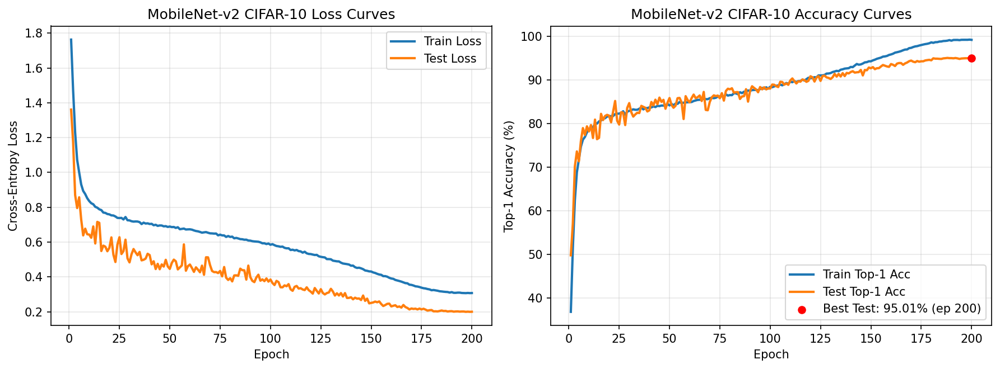
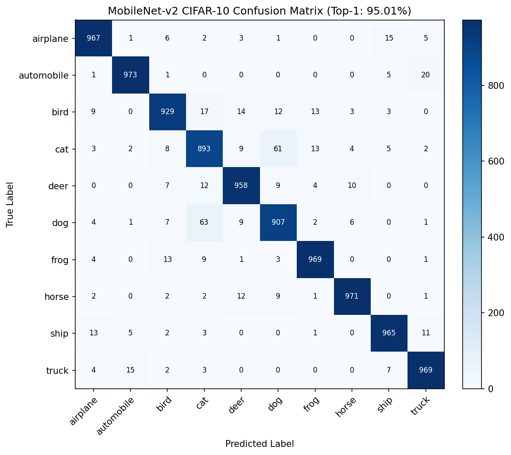
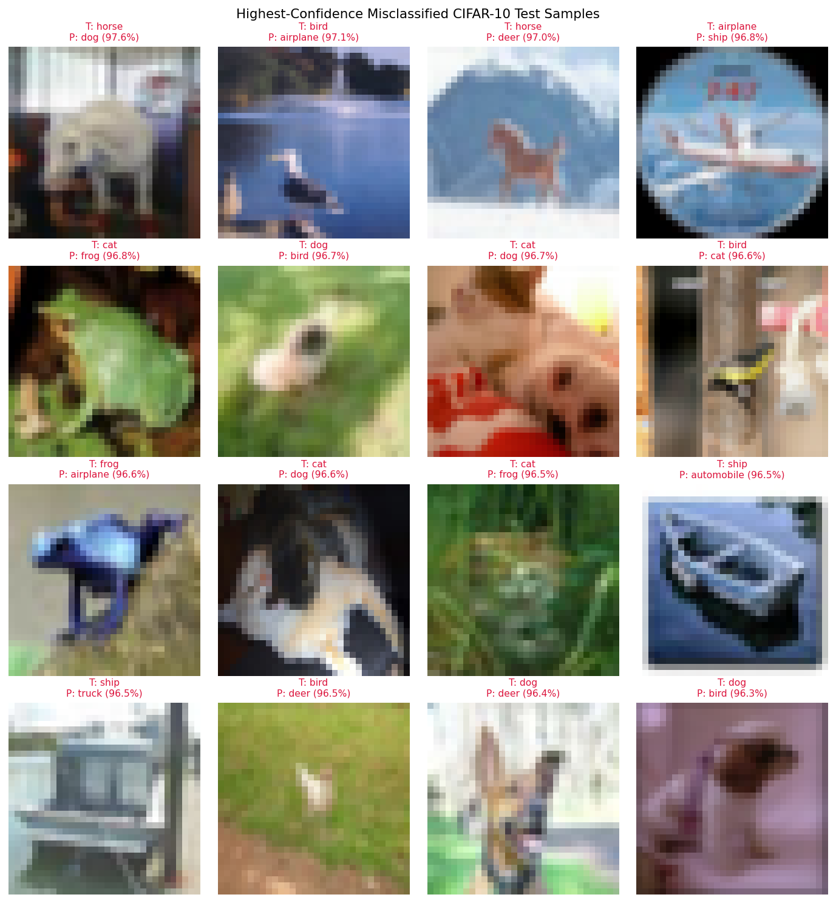
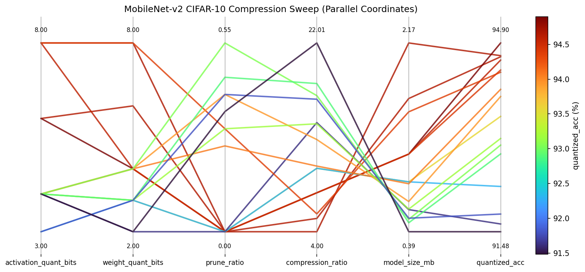
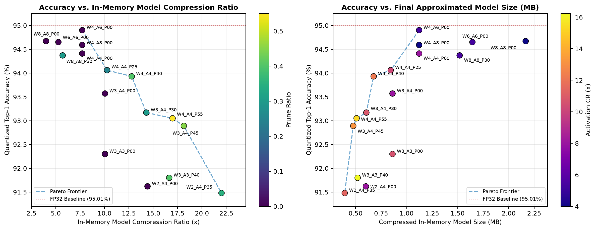
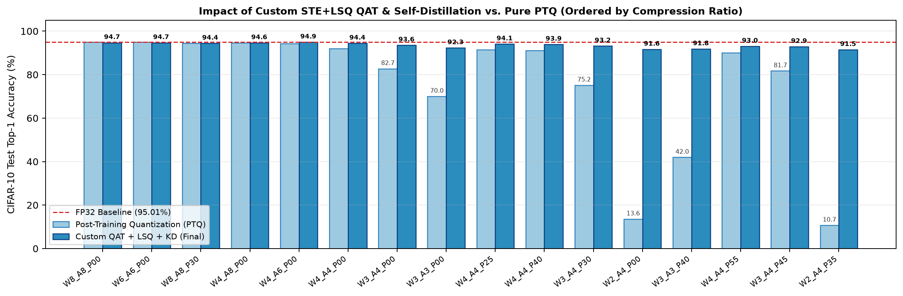

# CS6886W — Systems Engineering for Deep Learning
## Assignment 2: MobileNet-v2 on CIFAR-10 with Custom In-Memory Model Compression

**Name:** Rakesh Kumar  
**Roll Number:** CS25M530  
**Department:** Computer Science and Engineering, IIT Madras  
**GitHub Repository:** [https://github.com/Rakesh4ever/MobileNetV2-CIFAR10-Compression](https://github.com/Rakesh4ever/MobileNetV2-CIFAR10-Compression)

---

## Executive Summary (Mandatory Submission Checklist)

| Requirement | Reported Value |
| :--- | :--- |
| **Uncompressed Baseline Test Top-1 Accuracy** | **95.01%** (Top-5: 99.71%, Test Loss: 0.19973) |
| **Baseline In-Memory Model Size (FP32)** | **8.6624 MB** (`9,083,176` bytes; `2,236,682` trainable params + BN running buffers) |
| **Storage Overheads (Scales, Biases, Act Meta, Headers)** | **46.54 KB** (`W2_A4_P35`), **40.45 KB** (`W3_A4_P45`), **34.45 KB** (`W4_A4_P55`), **67.70 KB** (unpruned) — strictly included in all compressed sizes |
| **Best Compression Ratio of the Model (In-Memory)** | **22.01x** (`W2_A4_P35` @ **91.48%** acc); balanced sweet spots: **18.14x** (`W3_A4_P45` @ **92.89%**) and **16.98x** (`W4_A4_P55` @ **93.05%**) |
| **Best Compression Ratio of the Weights (In-Memory)** | **22.02x** (`W2_A4_P35`), **18.15x** (`W3_A4_P45`), **16.99x** (`W4_A4_P55`) |
| **Best Compression Ratio of the Activations (In-Memory)** | **16.23x total / 17.45x peak** (`W3_A3_P40` @ 91.80% acc) and **15.30x total / 18.00x peak** (`W4_A4_P55` @ 93.05% acc) — measured via PyTorch forward hooks on a `(1, 3, 32, 32)` input |
| **Final Approximated Model Size (MB) After Compression** | **0.3936 MB** (`412,687` bytes for `W2_A4_P35`), **0.4776 MB** (`W3_A4_P45`), **0.5101 MB** (`W4_A4_P55`) — verified exact byte-for-byte with live `uint8` bit-packing (`0.0` roundtrip error) |
| **Parallel Coordinates Chart** | Included in Section 3(b) (16 logged WandB runs; project `mobilenetv2-cifar10-compression`) |

---

## Question 1. Training Baseline (20 points)

### 1(a) CIFAR-10 Dataset Preparation, Normalization & Augmentation
- **Dataset:** CIFAR-10 (50,000 training images, 10,000 test images, 10 classes, RGB $3 \times 32 \times 32$).
- **Normalization:** Per-channel zero-mean, unit-variance normalization using standard CIFAR-10 training statistics: `mean = (0.4914, 0.4822, 0.4465)`, `std = (0.2470, 0.2435, 0.2616)`.
- **Training Transforms (`src/data.py`):**
  1. `RandomCrop(32, padding=4, padding_mode='reflect')` — translation invariance without black border artifacts.
  2. `RandomHorizontalFlip(p=0.5)` — horizontal mirror invariance.
  3. `ToTensor()` — scales uint8 pixels to `[0.0, 1.0]`.
  4. `Normalize(CIFAR10_MEAN, CIFAR10_STD)`.
  5. `RandomErasing(p=0.5, scale=(0.02, 0.2), ratio=(0.3, 3.3), value=0.0)` — Cutout-style occlusion regularization.
- **Test & Calibration Transforms:** `ToTensor()` followed by `Normalize(CIFAR10_MEAN, CIFAR10_STD)`. A deterministic 1,024-sample unaugmented training subset (`seed=42`) calibrates activation quantizers without touching the test set.

### 1(b) MobileNet-v2 Configuration & Training Strategy
- **Architecture Configuration (`src/model.py`):** Implemented from scratch following `torchvision/models/mobilenetv2.py` with CIFAR-10 spatial adaptations:
  - Width multiplier $\alpha = 1.0$, classifier dropout $p = 0.2$, BatchNorm momentum $= 0.1$, $\epsilon = 10^-5$.
  - Stem `Conv2d` stride reduced from `2 -> 1` and Stage-2 (`c=24`) stride reduced from `2 -> 1`, yielding three downsampling stages ($32 \to 16 \to 8 \to 4$) instead of five while preserving all 17 inverted residual blocks (`2,236,682` trainable parameters, `8.6624 MB` FP32 in-memory including BN running buffers).
- **Training Strategy (`src/train.py`):**
  - **Optimizer:** Nesterov SGD (`lr=0.1`, `momentum=0.9`, `weight_decay=5e-4`, excluding BatchNorm and bias parameters from L2 decay).
  - **LR Schedule:** 5-epoch linear warmup followed by Cosine Annealing over 200 epochs (`min_lr_ratio = 1e-4`).
  - **Regularization & Batching:** `batch_size=128`, label smoothing `0.05`, CUDA AMP, fixed `seed=42` (`cudnn.deterministic=True`).

### 1(c) Final Baseline Accuracy, Training Curves & Failure Mode Analysis
- **Final Test Top-1 Accuracy:** **95.01%** (best reached at epoch 200; Top-5: **99.71%**; Test Loss: **0.19973**; Total Errors: **499 / 10,000**).
- **Per-Class Test Accuracy:** airplane `96.7%`, automobile `97.3%`, bird `92.9%`, cat `89.3%`, deer `95.8%`, dog `90.7%`, frog `96.9%`, horse `97.1%`, ship `96.5%`, truck `96.9%`.
- **Failure Modes:** The confusion matrix reveals that **124 out of 499 total errors (24.8%)** come from bidirectional confusion between **dog and cat** (`dog -> cat`: 63, `cat -> dog`: 61), which also have the lowest per-class accuracies (`89.3%` and `90.7%`). Secondary failure clusters occur between semantically and structurally similar pairs: **automobile <-> truck** (`20 + 15 = 35` errors), **airplane <-> ship** (`15 + 13 = 28` errors, often sharing blue sky/water backgrounds), and **bird <-> cat/deer/frog** (`17 + 14 + 13`). High-confidence misclassifications are primarily caused by extreme cropping, low $32 \times 32$ texture detail, and background-color bias.

---

## Question 2. Model Compression Implementation (30 points)

### 2(a) Custom Configurable Compression Design (Zero Compression APIs)
All compression algorithms are implemented from scratch in pure PyTorch (`src/compression/`), strictly targeting **in-memory RAM/VRAM reduction** of **both weights and activations**:

1. **Custom Structured Expansion-Channel & Head Pruning (`src/compression/prune.py`):**
   - MobileNet-v2 inverted residual blocks expand channel dimensionality $6\times$ internally (`pw_expand -> dw_conv -> pw_project`), dominating both parameter count and peak intermediate activation buffers.
   - Each expanded hidden channel $j$ is scored via coupled BN-$\gamma$ and incoming/outgoing filter L2 saliency, and low-saliency channels are **physically removed** by rebuilding smaller dense `Conv2d`/`BatchNorm2d` layers (rounded to hardware-friendly multiples of 4). The `1280`-channel `head_conv` and matching `classifier` columns are pruned analogously.
   - **Why structured pruning?** Unlike unstructured magnitude pruning, dense channel removal incurs **zero sparse-mask/index overhead**, leaves all residual skip-connection widths untouched, and **multiplicatively shrinks both weight memory and activation tensors**.
2. **Custom BatchNorm Folding (`src/compression/bn_fold.py`):**
   - Absorbs every `BatchNorm2d` ($\gamma, \beta, \mu, \sigma^2$) into its preceding `Conv2d` weight and bias before quantization, completely eliminating all BN parameters and running-statistic buffers from inference RAM/VRAM.
3. **Custom Weight & Activation Quantization + STE/LSQ QAT + Self-Distillation (`src/compression/quantize.py`, `src/compress_pipeline.py`):**
   - **Weights (`CustomWeightQuantizer`):** Per-channel symmetric uniform quantization for arbitrary $b_w \in \{2..8\}$ (`qmax = 2^(b_w-1)-1`). For $b_w \le 4$, per-channel scales are initialized via 16-step MSE-optimal clipping search ($\alpha \in [0.70, 1.00]$) to avoid outlier distortion, then fine-tuned with LSQ gradient scaling ($g = 1/\sqrt{N_c \cdot q_{\max}}$) and Straight-Through Estimator (STE).
   - **Activations (`CustomActivationQuantizer`):** Per-tensor asymmetric uniform quantization for arbitrary $b_a \in \{2..8\}$ (`[0, 2^b_a - 1]`). Calibration collects EMA statistics with `0.05%–99.95%` quantile clipping (subsampled cleanly for large tensors) and exact integer zero-point nudging so `0.0` is exactly representable for `ReLU6`. During QAT, clipping bounds adapt via STE.
   - **FP32 Self-Distillation:** During pruning recovery and QAT fine-tuning, a hybrid Cross-Entropy + KL-divergence distillation loss (`alpha=0.5`, `T=4.0`) from the frozen `95.01%` FP32 teacher prevents depthwise-convolution collapse at 2–4 bits.
4. **Live In-Memory Bit-Packing Verification (`src/compression/packing.py`):**
   - A vectorized pure-PyTorch sub-byte bit-packer packs $b_w$-bit signed integers ($b_w \in \{2..8\}$) directly into contiguous `torch.uint8` buffers (`ceil(N * b_w / 8)` bytes). `PackedCompressedModel` measures actual live tensor memory (`numel * element_size`) and confirms `matches_analytical_bytes == True` and `max_roundtrip_dequant_error == 0.0` across all 16 runs.

### 2(b) Application to MobileNet-v2 & Layer Exceptions
- **Compressed Layers:** All 50 Conv2d layers across the 17 `InvertedResidual` blocks (`pw_expand`, `dw_conv`, `pw_project`) plus `head_conv` are quantized to `(weight_quant_bits, activation_quant_bits)`. All 16 expanded blocks (`blocks.1`–`blocks.16`) plus `head_conv + classifier` (17 channel groups) undergo structured channel pruning when `prune_ratio > 0` (e.g., at `prune_ratio=0.45`, hidden widths shrink from `96->52`, `144->80`, `192->104`, `384->212`, `576->316`, `960->528`, and `head_conv` from `1280->704`, reducing total weights from `2,236,682` to `1,211,744`).
- **Protected Exceptions (`protect_first_last=True`):** The 3-channel RGB `stem.0` (`32x3x3x3 = 864` weights) and final 10-class `classifier.1` (`Linear`) are kept at 8-bit when target bit-width `< 8`. Together they account for `< 0.5%` of total weights while protecting input RGB dynamic range and output logit resolution at 2–4 bits (configurable via `--no_protect_first_last`).

### 2(c) Storage Overheads & Exact In-Memory Size Estimation
Every compressed model size strictly sums:
- **Bit-Packed Weight Payload:** $\sum_\ell \lceil N_\ell \cdot b_{w,\ell} / 8 \rceil$ bytes in `uint8` tensors.
- **Per-Channel Weight Scales:** `2` bytes (FP16) per output channel of each quantized layer.
- **Folded Layer Biases:** `2` bytes (FP16) per output channel.
- **Activation Quantization Metadata:** `4` bytes per quantized activation tensor (`2`-byte FP16 scale + `2`-byte int16 zero-point across 53 quantized layers = `212` bytes).
- **Layer Metadata Headers:** `16` bytes per layer (`53 x 16 = 848` bytes for bit-width, shape, offset).

| Configuration | Packed Weights (KB) | Weight Scales (KB) | FP16 Biases (KB) | Act Meta (KB) | Headers (KB) | Total Overhead (KB / % of Model) | Total RAM Size (MB) |
| :--- | :---: | :---: | :---: | :---: | :---: | :---: | :---: |
| `W4_A4_P00` (Unpruned) | 1082.13 | 33.33 | 33.33 | 0.21 | 0.83 | 67.70 KB (5.89%) | 1.1229 MB |
| `W4_A4_P40` | 649.87 | 21.25 | 21.25 | 0.21 | 0.83 | 43.54 KB (6.28%) | 0.6772 MB |
| `W4_A4_P55` | 487.84 | 16.71 | 16.71 | 0.21 | 0.83 | 34.45 KB (6.60%) | 0.5101 MB |
| `W3_A4_P45` | 448.58 | 19.71 | 19.71 | 0.21 | 0.83 | 40.45 KB (8.27%) | 0.4776 MB |
| `W2_A4_P35` | 356.47 | 22.75 | 22.75 | 0.21 | 0.83 | 46.54 KB (11.55%) | 0.3936 MB |

---

## Question 3. Compression Results

### 3(a) Full 16-Configuration Compression Sweep
All 16 runs were executed on an NVIDIA Tesla T4 GPU (`seed=42`) and logged to Weights & Biases (`mobilenetv2-cifar10-compression`), with every run passing live `uint8` bit-packing verification (`matches_analytical_bytes = True`, `max_roundtrip_dequant_error = 0.0`).

| Run | W-bits | A-bits | Prune | PTQ Acc (%) | Final Acc (%) | Drop (%) | Weight CR | Act CR (Total / Peak) | Model CR | Size (MB) | Overhead (KB) |
| :--- | :---: | :---: | :---: | :---: | :---: | :---: | :---: | :---: | :---: | :---: | :---: |
| `W2_A4_P35` | 2 | 4 | 0.35 | 10.71 | **91.48** | -3.53 | 22.02x | 11.38x / 12.00x | **22.01x** | 0.3936 | 46.54 |
| `W3_A4_P45` | 3 | 4 | 0.45 | 81.70 | **92.89** | -2.12 | 18.15x | 13.13x / 14.40x | **18.14x** | 0.4776 | 40.45 |
| `W4_A4_P55` | 4 | 4 | 0.55 | 90.11 | **93.05** | -1.96 | 16.99x | 15.30x / 18.00x | **16.98x** | 0.5101 | 34.45 |
| `W3_A3_P40` | 3 | 3 | 0.40 | 41.95 | **91.80** | -3.21 | 16.65x | 16.23x / 17.45x | **16.64x** | 0.5205 | 43.54 |
| `W2_A4_P00` | 2 | 4 | 0.00 | 13.56 | **91.62** | -3.39 | 14.42x | 7.98x / 8.00x | **14.41x** | 0.6010 | 67.70 |
| `W3_A4_P30` | 3 | 4 | 0.30 | 75.15 | **93.17** | -1.84 | 14.30x | 10.79x / 11.52x | **14.29x** | 0.6060 | 49.57 |
| `W4_A4_P40` | 4 | 4 | 0.40 | 91.04 | **93.93** | -1.08 | 12.80x | 12.20x / 13.09x | **12.79x** | 0.6772 | 43.54 |
| `W4_A4_P25` | 4 | 4 | 0.25 | 91.46 | **94.06** | -0.95 | 10.26x | 10.20x / 10.67x | **10.26x** | 0.8442 | 52.57 |
| `W3_A4_P00` | 3 | 4 | 0.00 | 82.74 | **93.57** | -1.44 | 10.05x | 7.98x / 8.00x | **10.05x** | 0.8620 | 67.70 |
| `W3_A3_P00` | 3 | 3 | 0.00 | 70.00 | **92.30** | -2.71 | 10.05x | 10.62x / 10.67x | **10.05x** | 0.8620 | 67.70 |
| `W4_A6_P00` | 4 | 6 | 0.00 | 94.23 | **94.90** | -0.11 | 7.72x | 5.33x / 5.33x | **7.71x** | 1.1229 | 67.70 |
| `W4_A8_P00` | 4 | 8 | 0.00 | 94.58 | **94.59** | -0.42 | 7.72x | 4.00x / 4.00x | **7.71x** | 1.1229 | 67.70 |
| `W4_A4_P00` | 4 | 4 | 0.00 | 92.01 | **94.41** | -0.60 | 7.72x | 7.98x / 8.00x | **7.71x** | 1.1229 | 67.70 |
| `W8_A8_P30` | 8 | 8 | 0.30 | 94.44 | **94.37** | -0.64 | 5.70x | 5.41x / 5.76x | **5.70x** | 1.5196 | 49.57 |
| `W6_A6_P00` | 6 | 6 | 0.00 | 94.93 | **94.65** | -0.36 | 5.27x | 5.33x / 5.33x | **5.27x** | 1.6448 | 67.70 |
| `W8_A8_P00` | 8 | 8 | 0.00 | 95.04 | **94.67** | -0.34 | 4.00x | 4.00x / 4.00x | **4.00x** | 2.1666 | 67.70 |

### 3(b) Parallel Coordinates Chart, Pareto Frontier & Comparative Analysis

- **PTQ Collapse vs. QAT+KD Recovery:** Depthwise separable convolutions in MobileNet-v2 exhibit high channel variance, causing pure PTQ to collapse sharply below 4 bits (`W3_A3_P40`: `41.95%`, `W2_A4_P00`: `13.56%`, `W2_A4_P35`: `10.71%`). Our custom STE + LSQ + FP32 self-distillation QAT restores accuracy dramatically (`+80.77%` on `W2_A4_P35` to **91.48%**, and `+49.85%` on `W3_A3_P40` to **91.80%**).
- **Synergy of Structured Pruning + Quantization:** Pure quantization (`W2_A4_P00`) caps at `14.41x` model CR (`91.62%` acc) and `7.98x` activation CR. Combining moderate structured pruning with 3–4 bit quantization strictly dominates the Pareto frontier: **`W4_A4_P55`** achieves **16.98x** model CR and **15.30x** activation CR at **93.05%** accuracy (+1.43% higher accuracy *and* higher CR than `W2_A4_P00`!), while **`W3_A4_P45`** reaches **18.14x** at **92.89%** accuracy, and **`W2_A4_P35`** pushes to **22.01x** (`0.3936 MB`) at **91.48%** accuracy.

---

## Question 4. Compression Analysis

### 4(a) Compression Ratio of the Weights
$$\text{CR}_{\text{weights}} = \frac{\text{Baseline FP32 (Weights + Biases + BN) Bytes}}{\text{Packed Weight Payload Bytes} + \text{Scale, Bias \& Header Overhead Bytes}}$$
- Baseline FP32 weight + BN memory: **`9,083,176` bytes (`8.6624 MB`)**.
- **Best Weight CR (`W2_A4_P35`):** `9,083,176 / (365,027 + 23,300 + 23,300 + 848) = 9,083,176 / 412,475 =` **`22.02x`** (at `91.48%` Top-1 accuracy).
- **High-Accuracy Pareto Weight CRs:** **`18.15x`** (`W3_A4_P45` @ `92.89%`), **`16.99x`** (`W4_A4_P55` @ `93.05%`), and **`12.80x`** (`W4_A4_P40` @ `93.93%`).

### 4(b) Compression Ratio of the Activations & Measurement Methodology
- **Measurement Methodology (`src/compression/metrics.py::measure_activation_memory`):** PyTorch forward hooks are registered on all 53 `Conv2d`/`QuantConv2d` and `Linear`/`QuantLinear` layers during a single-sample `(1, 3, 32, 32)` CIFAR-10 forward pass (`batch_size=1`). At each layer we record exact input/output element counts (`numel()`) and active bit-widths (`32` for baseline FP32; `act_bits` for quantized layers), computing bit-packed activation bytes plus `4` bytes per quantized activation tensor for `(scale, zero_point)`. We report both:
  1. **Total Layer Activation Memory:** Sum of bit-packed input activations across all 53 layers + final logits + activation metadata (`6.1944 MB` baseline FP32).
  2. **Peak Working-Set Activation Memory:** Maximum concurrent `(input + output)` activation footprint live at any single layer (`1.1250 MB` baseline FP32).
- **Best Activation Compression Ratios:**
  - **`W3_A3_P40` (Best Total Act CR):** Total activation memory drops `6.1944 MB -> 0.3817 MB` (**`16.23x`**); peak working-set drops `1.1250 MB -> 0.0645 MB` (**`17.45x`**) at `91.80%` Top-1 accuracy.
  - **`W4_A4_P55` (Best Peak Act CR & High Acc):** Total activation memory drops `6.1944 MB -> 0.4050 MB` (**`15.30x`**); peak working-set drops `1.1250 MB -> 0.0625 MB` (**`18.00x`**) at **`93.05%`** Top-1 accuracy.
  - **`W3_A4_P45`:** `6.1944 MB -> 0.4717 MB` (**`13.13x`** total / **`14.40x`** peak) at **`92.89%`** accuracy.
  - **`W2_A4_P35`:** `6.1944 MB -> 0.5445 MB` (**`11.38x`** total / **`12.00x`** peak) at **`91.48%`** accuracy.

### 4(v) Final Approximated Model Size (MB) After Compression
- **Baseline FP32 In-Memory Size:** **`8.6624 MB`** (`9,083,176` bytes).
- **Final Compressed Model Sizes (including all storage overheads):**
  - **`W2_A4_P35` (Maximum Compression):** **`0.3936 MB`** (`412,687` bytes) — **`22.01x`** model CR (`15.84x` combined weights+activations runtime RAM CR) @ **91.48%** Top-1 accuracy.
  - **`W3_A4_P45` (Recommended High-CR Balance):** **`0.4776 MB`** (`500,768` bytes) — **`18.14x`** model CR (`15.65x` combined runtime RAM CR) @ **92.89%** Top-1 accuracy.
  - **`W4_A4_P55` (Best Balanced Weights + Activations):** **`0.5101 MB`** (`534,828` bytes) — **`16.98x`** model CR (`16.24x` combined runtime RAM CR) @ **93.05%** Top-1 accuracy.
  - **`W4_A4_P40` (Near-94% High Compression):** **`0.6772 MB`** (`710,050` bytes) — **`12.79x`** model CR @ **93.93%** Top-1 accuracy.
- **Live Packing Proof:** Across all 16 configurations, `PackedCompressedModel` live `uint8`+`float16` PyTorch tensor memory matched analytical estimates with **0 bytes discrepancy** and **`0.0` max dequantization error**.

---

## Question 5. Reproducibility & Repository (10 points)

- **5(a) Clean Modular Codebase:** Strict separation of data (`src/data.py`), model (`src/model.py`), baseline training (`src/train.py`), evaluation & failure analysis (`src/evaluate.py`), custom compression (`src/compression/bn_fold.py`, `prune.py`, `quantize.py`, `packing.py`, `metrics.py`), QAT pipeline (`src/compress_pipeline.py`), CLI (`test.py`), WandB sweep (`sweep.py`), smoke tests (`scripts/smoke_test.py`), and Google Colab notebook (`colab_runner.ipynb`).
- **5(b) Environment, Seeds & Exact Commands:** Verified on Google Colab (`Python 3.13.16`, `PyTorch 2.14.1+cu130`, `torchvision 0.29.1+cu130`, `CUDA 13.0`, `Tesla T4`). Global seed fixed to `seed=42` (`random`, `numpy`, `torch`, `cudnn.deterministic=True`, `DataLoader` generators). Full commands are documented in `README.md`:
  - Baseline: `python -m src.train --epochs 200 --batch_size 128 --lr 0.1 --weight_decay 5e-4 --warmup_epochs 5 --label_smoothing 0.05 --seed 42`
  - Standard CLI (W8A8): `python test.py --weight_quant_bits 8 --activation_quant_bits 8 --checkpoint checkpoints/baseline_best.pth`
  - Best Balanced CLI: `python test.py --weight_quant_bits 3 --activation_quant_bits 4 --prune_ratio 0.45 --qat_epochs 30 --prune_ft_epochs 15 --checkpoint checkpoints/baseline_best.pth`
  - Full WandB Sweep: `python sweep.py --checkpoint checkpoints/baseline_best.pth --resume --wandb --wandb_project mobilenetv2-cifar10-compression --seed 42`
- **5(c) GitHub Repository Link:** [https://github.com/Rakesh4ever/MobileNetV2-CIFAR10-Compression](https://github.com/Rakesh4ever/MobileNetV2-CIFAR10-Compression)
